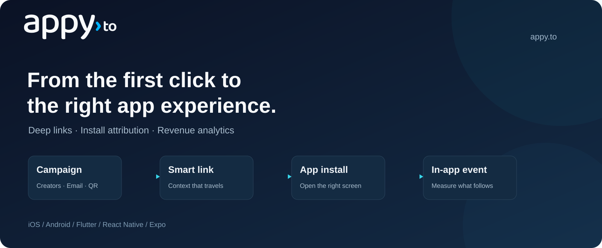

# Appy for Flutter



Deep links, install attribution and in-app events for Flutter on iOS and Android.

**Source preview** · Flutter 3.44+ · iOS 13+ / Android API 21+ · [MIT](LICENSE)

[Step-by-step setup](QUICKSTART.md) · [Your dashboard values](SETUP.md) · [API reference](#api-reference) · [Support](mailto:support@appy.to)

## Quick start

### 1. Get your app's key and domain

In the [Appy dashboard](https://appy.to), open **Apps & SDK → New app**. Register your own app, then copy **Publishable key** and **Link domain** from **SDK setup**. The hosted SDK features require an Enterprise plan.

Replace `YOUR_PUBLISHABLE_KEY` and `your-app.appy.to` below with those two values. Keep the SDK/package names as written. [Help finding your values](SETUP.md).

### 2. Install

The package is not published on pub.dev yet. Use [Source setup](SOURCE_SETUP.md) to download the plugin and native SDKs, then run the included example. A registry install command will be added when the package is published.

### 3. Configure and connect links

Add `import 'package:appy_sdk/appy_sdk.dart';` at file scope. In your existing `main()`, after `WidgetsFlutterBinding.ensureInitialized()` and before `runApp(...)`:

```dart
await Appy.configure(const AppyConfiguration(
  publishableKey: 'YOUR_PUBLISHABLE_KEY',
  linkDomains: ['your-app.appy.to'],
));
```

Finish the required setup: [configure iOS and Android links](#2-platform-setup), then [listen for deep links](#4-handle-deep-links).

### 4. Test your first link

Create a link for this dashboard app, install the matching app build and tap the link. Confirm that your deep-link handler receives it before testing fresh installs or adding event tracking. [Follow the complete walkthrough](QUICKSTART.md).

---

## Detailed guide

The sections below cover platform settings, callbacks, events, consent, troubleshooting and the API. Start here when you need a specific integration detail.

## Requirements

- Flutter 3.44 or later, Dart 3.12 or later.
- iOS 13 or later, Android 5.0 (API 21) or later.
- An app registered with Appy and its publishable key (`appy_pk_…`). The SDK endpoints are part of the Appy Enterprise plan; keys on other plans receive `403 plan_required`, which the first launch reports as `AppyDeepLinkFailed(AppyError.invalidResponse)`.

## Install

This is currently a **source preview**. Follow [Build the example from source](SOURCE_SETUP.md) to download this package and its native dependencies. A one-command registry install is not available yet.

After that source setup, the sections below explain how to connect the SDK to your app. Keep the existing native dependency setup from the source guide.

## 1. Register your app

Open **Apps & SDK → New app** in the [Appy dashboard](https://appy.to). Enter your own app name, choose its link subdomain, and select the platforms you ship:

- **iOS:** your Apple Team ID and the Bundle ID from Xcode.
- **Android:** your `applicationId` and the SHA-256 fingerprints of the signing certificates used for your builds, including Play App Signing for Play Store builds.

Select **Register app**. Open **SDK setup** on the app's page and copy the **Publishable key** and **Link domain**. One dashboard app can contain both platforms. [Where to find every value](SETUP.md).

In the examples, replace `YOUR_PUBLISHABLE_KEY` and `your-app.appy.to` with those copied values. Keep the `Appy` class names and package/import names. You do not need a secret API key or a terminal registration request.

## 2. Platform setup

Appy delivers its links through `Appy.onDeepLink`. Flutter's built-in deep linking would also push the link's path, such as `/spring`, onto your router, so turn it off.

### iOS

1. In Xcode, open `ios/Runner.xcworkspace`, select the **Runner** target, add the **Associated Domains** capability and enter `applinks:your-app.appy.to` with your link domain. While developing, add `applinks:your-app.appy.to?mode=developer` too.
2. Under **Info > URL Types**, add your app's URL scheme, for example `yourapp`. In-app browsers that ignore Universal Links open this scheme instead.
3. In `ios/Runner/Info.plist`, turn off Flutter's deep linking:

   ```xml
   <key>FlutterDeepLinkingEnabled</key>
   <false/>
   ```

The plugin receives links from both the app delegate and the scene delegate, so it works before and after the UIScene migration.

### Android

In `android/app/src/main/AndroidManifest.xml`, inside the `<activity>` of `MainActivity`:

```xml
<meta-data android:name="flutter_deeplinking_enabled" android:value="false" />

<intent-filter android:autoVerify="true">
    <action android:name="android.intent.action.VIEW" />
    <category android:name="android.intent.category.DEFAULT" />
    <category android:name="android.intent.category.BROWSABLE" />
    <data android:scheme="https" android:host="your-app.appy.to" />
</intent-filter>

<intent-filter>
    <action android:name="android.intent.action.VIEW" />
    <category android:name="android.intent.category.DEFAULT" />
    <category android:name="android.intent.category.BROWSABLE" />
    <data android:scheme="yourapp" />
</intent-filter>
```

Keep the activity's `launchMode` at Flutter's default `singleTop`, so links that arrive while the app runs reach the running activity. Android Auto Backup can restore the SDK's state on a reinstall and hide the first launch; exclude `to.appy.sdk.xml` as shown in [Keep the first launch a first launch](https://appy.to/docs/sdk/android#keep-the-first-launch).

## 3. Configure

Configure once, as early as possible, before `runApp`:

```dart
import 'package:appy_sdk/appy_sdk.dart';
import 'package:flutter/foundation.dart';
import 'package:flutter/material.dart';

Future<void> main() async {
  WidgetsFlutterBinding.ensureInitialized();
  await Appy.configure(AppyConfiguration(
    publishableKey: 'YOUR_PUBLISHABLE_KEY',
    linkDomains: const ['your-app.appy.to'],
    logLevel: kDebugMode ? AppyLogLevel.debug : AppyLogLevel.error,
  ));
  runApp(const MyApp());
}
```

| Option | Default | Meaning |
|---|---|---|
| `publishableKey` | required | Your `appy_pk_…` key. Never ship a secret key (`appy_sk_…`). |
| `linkDomains` | `[]` | Hosts of your Appy links. The first one is used by `buildLink`. |
| `emailLinkDomains` | `[]` | Click-tracking domains of your email tool that open the app. The native SDKs resolve their links to the destination, as described in the [iOS](https://appy.to/docs/sdk/ios#links-in-marketing-email) and [Android](https://appy.to/docs/sdk/android#links-in-marketing-email) guides. Add the domains to Associated Domains and to a verified intent filter too. |
| `logLevel` | `error` | `none`, `error`, `warning`, `info` or `debug`. |
| `openDeferredDeepLinks` | `false` | Let the SDK open a deferred link's in-app URL itself. See [Deferred deep links](#5-deferred-deep-links). |
| `deferredDeepLinkTimeout` | 5 s | How long the first launch waits for Appy's answer before `onDeepLink` reports `AppyError.timeout`. |
| `launchLinkWaitInterval` | 500 ms | How long a launch waits for a link, so a cold start from a link sends one request. |
| `requestTimeout` | 10 s | Timeout per HTTP attempt. |
| `apiBaseUrl` | `https://api.appy.to` | Change only for staging. |
| `android.collectInstallReferrer` | `true` | Read the store's install referrer on the first Android launch. |
| `android.metaAppId` | none | Your Facebook App ID, to read the Meta Install Referrer. See [Install attribution](#6-install-attribution). |

Links that open the app before `configure` runs, such as the link of a cold start, are kept by the native SDK and resolved right after it. A second `configure` call in the same process, for example after a hot restart, is ignored.

## 4. Handle deep links

`Appy.onDeepLink` is a broadcast stream of `AppyDeepLinkResult`, a sealed class:

| Result | Meaning |
|---|---|
| `AppyDeepLinkFound(link)` | An Appy link opened the app, or on the first launch Appy found the link tapped before the install (`link.isDeferred` is `true`). |
| `AppyDeepLinkNotFound()` | First launch only. Appy answered, and no Appy link led to this install. |
| `AppyDeepLinkFailed(error)` | First launch only. `AppyError.timeout`, `AppyError.network` or `AppyError.invalidResponse` (for example an invalid key). |

When it emits:

- on the first launch after install, exactly once, with one of the three results;
- every time an Appy link opens the app, cold or warm, with `AppyDeepLinkFound`;
- on no other launch.

A result that arrives while nothing listens is kept by the native SDK and delivered once, to the next listener; when several arrive, the most recent link wins. Listen from a widget that lives as long as the app, or from your router setup:

```dart
final subscription = Appy.onDeepLink.listen((result) {
  switch (result) {
    case AppyDeepLinkFound(:final link):
      final item = link.parameters['item'];
      router.go(item != null ? '/items/$item' : '/campaigns/${link.slug}');
    case AppyDeepLinkNotFound() || AppyDeepLinkFailed():
      break;
  }
});
```

An `AppyDeepLink` has:

| Property | Meaning |
|---|---|
| `url` | The Appy link, for example `https://your-app.appy.to/spring?item=42` |
| `deeplinkUrl` | The in-app destination set on the link, for example `yourapp://items?item=42` |
| `slug` | The link's slug, for example `spring` |
| `parameters` | The link's query parameters, including `utm_*`, without the reserved `appy_` ones |
| `isDeferred` | `true` when the link was tapped before the app was installed |
| `clickedAt` | When the link was tapped, if known (UTC) |

When Appy cannot be reached, a link that opened the app still arrives as `AppyDeepLinkFound`, read from the URL itself: `slug` is the first path segment and `deeplinkUrl` and `clickedAt` are `null`. Make your routing work from `slug` and `parameters` too.

`Appy.getLatestDeepLink()` returns the most recent link, including a deferred link that arrived after the timeout.

**Links from push notifications, in-app messages or QR scanners** reach your code as a URL. Pass it to `Appy.handleUrl`; an Appy link then arrives on `onDeepLink` and counts as an app open:

```dart
Future<void> onNotificationTap(String link) async {
  final uri = Uri.parse(link);
  if (!await Appy.handleUrl(uri)) {
    router.go(uri.path);
  }
}
```

**Other link plugins.** If you also use a plugin such as `app_links` for other domains, it may receive Appy links as well. Ignore your Appy link domain there and route Appy links only from `onDeepLink`.

## 5. Deferred deep links

When someone taps an Appy link without your app installed, Appy remembers the tap and sends them to the store. On the first launch after install the plugin asks Appy for that link, and `onDeepLink` emits `AppyDeepLinkFound` with `isDeferred == true`, or `AppyDeepLinkNotFound` for an organic install. On Android the store's install referrer carries the link; on iOS Appy matches the install to the tap. The answer comes within `deferredDeepLinkTimeout`, counted from `configure`; until Appy has answered a first launch, later launches ask again.

With `openDeferredDeepLinks: true`, the SDK also opens the deferred link's `deeplinkUrl` (for example `yourapp://items?item=42`) after emitting it. Your app receives that URL like any other link to its own scheme, so route deferred links either from `onDeepLink` or from your URL scheme handler, not both. The SDK opens only URLs your app registered, so it never sends the user to a browser.

To test, delete the app, tap an Appy link on the same device, install your build and open it. Every install gets a new random install ID, so there is nothing to reset.

## 6. Install attribution

`Appy.onAttribution` emits once, when Appy answers the first launch, also when that answer came after the deep link timeout. `Appy.getAttribution()` returns the stored value on every later launch, or `null` until Appy has answered.

```dart
Appy.onAttribution.listen((attribution) {
  analytics.setUserProperty(
    name: 'acquisition',
    value: attribution.isOrganic ? 'organic' : attribution.campaign ?? attribution.linkSlug,
  );
});
```

| Property | Meaning |
|---|---|
| `isOrganic` | `true` when no Appy link or ad network led to the install |
| `linkSlug`, `linkTitle` | The link that brought the install |
| `source`, `medium`, `campaign` | The `utm_source`, `utm_medium` and `utm_campaign` of the tapped link |
| `clickedAt` | When the link was tapped |
| `network` | Set when an ad network attributed the install instead of an Appy link: `name` (`google_ads`, `meta`), campaign, ad group, ad, `clickId` and `touch` |

- **Apple Ads**: on iOS 14.3 and later the iOS SDK sends the AdServices attribution token on the first launch. Nothing to configure; the result appears on the install in the dashboard and in install postbacks.
- **Google Ads**: a `gclid` in the Play install referrer marks the install as Google Ads. Nothing to configure.
- **Meta**: set `AppyAndroidOptions(metaAppId: '<Facebook App ID>')` and add the Install Referrer decryption key to your app in the Appy dashboard.

Attribution on the device is for analytics and personalization. Before you grant a referral reward, look the install up from your backend and check `attribution.verified`; see [Install attribution](https://appy.to/docs/attribution).

## 7. Track events

```dart
await Appy.track('signup');
await Appy.track('add_to_cart', properties: {'sku': 'A1', 'qty': 2, 'gift': false});
await Appy.track('purchase', properties: {'sku': 'A1'}, revenue: 19.98, currency: 'USD', deduplicationId: purchase.purchaseID);
```

- Names are 1 to 64 characters. Property values are `String`, `num` or `bool`; other values are dropped. At most 50 properties, strings up to 512 characters.
- `revenue` needs a three-letter `currency`. Negative revenue (refunds) is allowed.
- `deduplicationId` is the store's transaction ID: the App Store transaction ID or the Google Play order ID (`PurchaseDetails.purchaseID` with `in_app_purchase`). Appy counts a purchase once, even when it is tracked again after a restore or also reported by your backend with the same ID.

Events are queued on disk and sent in batches: 2 seconds after the last `track`, when 20 are waiting, when the app goes to the background, or when you call `Appy.flush()`.

## 8. Users, privacy and consent

```dart
await Appy.setUserId('u_123');
await Appy.setUserId(null);
```

Call it after sign-in, and with `null` on sign-out. Use an opaque internal ID, not an email address.

`Appy.setTrackingEnabled(false)` is stored across launches. While tracking is off, no launch open, deferred deep link lookup or event is sent, and links that open the app still resolve without being stored. If you ask for consent first, turn tracking off before `configure` until the user answers:

```dart
if (!consent.hasAnswered) {
  await Appy.setTrackingEnabled(false);
}
await Appy.configure(configuration);

consent.onAnswer = (granted) => Appy.setTrackingEnabled(granted);
```

When tracking turns on, the first-launch lookup starts and `onDeepLink` and `onAttribution` follow. The SDKs read no advertising ID, show no App Tracking Transparency prompt and ship a privacy manifest on iOS. Data handling is described in the [iOS](https://appy.to/docs/sdk/ios#privacy-and-consent) and [Android](https://appy.to/docs/sdk/android#privacy-and-consent) guides.

## 9. Share links

```dart
final url = await Appy.buildLink('spring', parameters: {'ref': referralCode});
```

This returns `https://your-app.appy.to/spring?ref=…` on the first link domain, or `null` before `configure`, without a link domain, or for an invalid slug. The slug must belong to a link in your account.

## 10. Debugging

Set `logLevel: AppyLogLevel.debug`. On Android run `adb logcat -s Appy`; on iOS filter the Xcode console or Console.app on `subsystem:to.appy.sdk`.

```bash
xcrun simctl openurl booted "https://your-app.appy.to/spring?item=42"
adb shell 'am start -W -a android.intent.action.VIEW -c android.intent.category.BROWSABLE -d "https://your-app.appy.to/spring?item=42"'
```

| Symptom | Check |
|---|---|
| Links open the browser | The AASA file or `assetlinks.json` for your domain, the Team ID or SHA-256 fingerprint of the build you run, `applinks:` and `autoVerify`. |
| The router opens a "not found" page for `/spring` | Flutter's deep linking is still on: `FlutterDeepLinkingEnabled` and `flutter_deeplinking_enabled`. |
| `onDeepLink` never emits | `configure` runs at startup, the domain is in `linkDomains`, and something listens to the stream. |
| `AppyDeepLinkFailed(invalidResponse)` | HTTP 401 or 403 in the log: the publishable key, or a plan without SDK access. |

## API reference

| `Appy` | |
|---|---|
| `configure(AppyConfiguration)` | Starts the SDK. Call once, early. |
| `onDeepLink` | Broadcast stream of `AppyDeepLinkResult`. |
| `onAttribution` | Broadcast stream of `AppyAttribution`, once per install. |
| `getAttribution()` | The stored install attribution, or `null`. |
| `getLatestDeepLink()` | The most recent link, or `null`. |
| `handleUrl(Uri)` | Resolves an Appy link received another way; `false` for other URLs. |
| `track(name, {properties, revenue, currency, deduplicationId})` | Queues an event. |
| `setUserId(String?)` | Sets or clears the user ID. |
| `setTrackingEnabled(bool)`, `isTrackingEnabled()` | Stored opt-out, on by default. |
| `buildLink(slug, {parameters})` | Builds a share link. |
| `flush()` | Sends queued events now. |
| `nativeSdkVersion()` | The version of the native SDK in the app. |
| `pluginVersion` | This plugin's version. |

## Versions

| `appy_sdk` | Appy iOS SDK | Appy Android SDK |
|---|---|---|
| 1.0.0 | 1.0.x | 1.0.x |

## License

MIT. See [LICENSE](LICENSE).

## Third-party licensing

The Appy source in this repository uses the [MIT license](LICENSE). Third-party libraries and platform SDKs keep their own licenses. The Android implementation depends on `com.android.installreferrer:installreferrer:2.2`; its published POM identifies the [Android Software Development Kit License](https://developer.android.com/studio/terms). Obtain it from Google's Maven repository and retain applicable notices; the Appy MIT license does not relicense this dependency.
